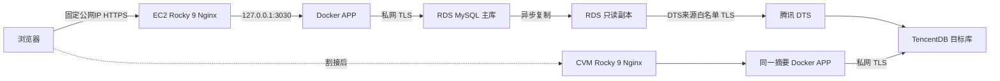

# Rocky Linux 9：AWS 容器部署与腾讯云迁移操作手册

适用项目：passenger-flow-docker；编写日期：2026-10-08。

本手册交付部署工具，由你审核 Terraform 计划后创建付费资源。本轮没有创建云服务器、RDS、TencentDB、DTS 任务，没有推送镜像，也没有提交 Git。原客流程序、现有本地配置和数据库卷保留。

## 1. 先读结论与实施顺序

1. Windows 上验证代码和 Terraform。
2. 启用 AWS 香港地域，核对官方 Rocky 9 镜像、RDS MySQL 8.4 版本和价格。
3. 创建状态桶，然后创建 AWS 网络、EC2、ECR、RDS 主库与只读副本。
4. 上传镜像，在 EC2 初始化源库，一键部署并验证可信 IP HTTPS 登录。
5. 腾讯端先确认数据库规格支持 TLS，再创建基础环境。
6. DTS 从 AWS 只读副本迁移到 TencentDB，腾讯 APP 先只读验证。
7. 停写、等待两段复制追平、内容对账；通过后开放腾讯 APP 写入。

**当前腾讯端有一项阻断条件：** 官方功能列表未确认“单节点 MySQL 8.4”支持 SSL。Terraform 的 target_tls_verified 默认为 false，阻止创建目标数据库。不得仅为通过计划把它改成 true。先取得腾讯对香港地域、单节点云盘、8.4、TLS、证书端点验证的明确确认；不支持时另行批准规格/架构调整及费用。不会自动使用明文或升级配置。参见[官方功能列表](https://cloud.tencent.com/document/product/236/43502)和[SSL 说明](https://intl.cloud.tencent.com/zh/document/product/236/48452)。

以下步骤中的 REPLACE、示例账号、地址、ID 都需要换成你的实际值。复制示例变量文件后会因占位符被拒绝，这是预期保护。

## 2. 架构、规格与能力边界



| 项目 | 默认值 | 注意 |
| --- | --- | --- |
| AWS 地域 | ap-east-1，香港 | 需账户主动启用 |
| EC2 | t3.medium，2 vCPU/4 GiB，40 GiB gp3 | 单台应用 |
| RDS | 主库和只读副本各 db.t4g.medium、50 GiB gp3 | 存储自动增长上限100 GiB，会增加费用 |
| RDS 版本 | 明确的 8.4.x 补丁版本 | 预检后填写，不自动换版本 |
| 腾讯地域 | ap-hongkong | 售卖规格需现场核对 |
| CVM | 可售 x86_64 2核4GB、40GB系统盘 | 不自动选择更贵机型 |
| TencentDB | 单节点云盘2核4GB/50GB/8.4 | TLS阻断条件必须先解决 |
| 宿主机 | Rocky Linux 9 x86_64 | 镜像ID锁定，系统安全更新不锁死 |
| APP 镜像 | 现有 Node 24 Alpine 基础摘要 | 部署应用也使用仓库@sha256摘要 |
| APP 到数据库 | 5个连接 | 最多5名用户是验收规模，不是性能保证 |

RDS 两台实例是“一台写主库＋一台可查询的异步只读副本”。没有第三台自动接管的 Multi-AZ standby，副本也不自动成为写主库。APP 当前仍连接主库，未改成自动读写分离；副本用于迁移读取。参见[AWS 只读副本说明](https://docs.aws.amazon.com/AmazonRDS/latest/UserGuide/USER_ReadRepl.html)。

不创建 Kubernetes、ALB、NAT Gateway、跨云VPN。AWS EC2位于公网子网并配置固定EIP；RDS主库位于私网子网；副本位于带互联网路由的子网且有公网可访问属性，但3306默认没有公网入站规则。腾讯数据库不申请公网连接。

## 3. 文件、配置及密码在哪里

### 仓库内容

| 路径 | 用途 |
| --- | --- |
| infra/bootstrap/ | 加密、版本化、禁止公网访问的S3状态桶 |
| infra/aws/ | VPC、网络、安全组、EC2、EIP、ECR、RDS、告警 |
| infra/tencent/ | VPC、安全组、CVM、EIP、TencentDB、7天备份 |
| cloud-tools.bat | Windows操作入口，默认只验证 |
| deploy/cloud/cloud-tools.ps1 | 预检、计划、确认创建、导出端点、镜像发布 |
| deploy/cloud/setup-rocky9.sh | Rocky9软件准备、SELinux、firewalld、Docker |
| deploy/cloud/deploy.sh | 配置、源库初始化、部署、验证、回退、停写 |
| deploy/cloud/compose.yaml | 仅APP，云端不运行本地MySQL容器 |
| deploy/cloud/tls-ip.sh | IP证书签发、Nginx安装、续期配置 |
| scripts/cloud-db.js | 源库初始化、数据库TLS检查、副本检查 |
| tests/cloud-container.py | 隔离MySQL8.4容器验收，不使用旧数据卷 |

### 云服务器最终位置

| 路径 | 内容 |
| --- | --- |
| /opt/passenger-flow-cloud/ | deploy/cloud/下的脚本与Compose文件 |
| /etc/passenger-flow/config.json | root可读的配置，包含业务密码和网页登录密码 |
| /etc/passenger-flow/app.env | APP配置，以raw格式交给Compose，避免特殊字符被插值 |
| /etc/passenger-flow/deploy.env | 指定不可变APP镜像摘要 |
| /etc/passenger-flow/db-ca.pem | 数据库CA证书 |
| /etc/nginx/conf.d/passenger-flow.conf | Nginx HTTP验证/HTTPS反向代理 |
| /etc/systemd/system/passenger-flow.service | 应用开机启动 |
| /etc/systemd/system/passenger-cert-renew.* | 证书续期服务、定时器 |
| /etc/letsencrypt/live/公网IP/ | 正式IP证书及私钥 |
| /var/lib/passenger-flow/reports/ | 快照、对账及诊断结果 |
| /var/lib/passenger-flow/backups/ | 发布配置备份及Nginx备份，含敏感内容 |

**四类账号各不相同：**

| 账号 | 使用位置 | 保管方式 |
| --- | --- | --- |
| RDS管理员 pfadmin / TencentDB root | 创建账号、建表、设置Binlog保留 | Windows DPAPI密文＋你的密码管理器；服务器仅交互读取 |
| passenger_app | APP连接数据库 | 服务器root专用config.json和app.env |
| 网页账号 cloud-admin或自行填写 | 浏览器Basic Auth | config.json，不使用数据库密码登录网页 |
| passenger_dts | DTS读取RDS副本 | 初始化时自行输入并保存到密码管理器，提交DTS时使用 |

查看服务器上你的网页登录和业务数据库密码：

```bash
sudo less /etc/passenger-flow/config.json
```

这是本机受控查看，**不要把内容粘到聊天、日志、Git或截图里**。管理员密码和DTS密码不保存在该文件。普通启动不会打印密码。密码可以含美元符号、井号、引号、反斜线及空格，但禁止换行/NUL；RDS管理员还有云厂商字符和长度限制。

## 4. Windows准备与只读验证

在项目根目录打开PowerShell：

```powershell
cd "C:\Users\David Huang\Documents\codex-tools\passenger-flow-docker"
.\cloud-tools.bat -Action Validate
.\verify-docker-acceptance.bat
```

需要Terraform >=1.11、<2.0、AWS CLI v2、Docker Desktop Linux引擎。TerraformProvider锁定AWS6.68.0、Tencent1.83.34；提交三个目录的.terraform.lock.hcl，含Windows/Linux校验摘要。Validate下载Provider并检查结构，不连接数据库、不创建资源。若工作机没有Terraform，先从HashiCorp官方渠道安装并校验。

本地旧验证脚本保持不变；验收环境3031和本地普通环境3030继续独立。云容器测试使用新的3032独立项目，结束只清理其自己的测试容器和卷。

开发者复跑：

```powershell
npm ci
npm test
npm run lint
python tests/cloud-config.test.py
python tests/cloud-terraform.py
python tests/cloud-container.py
```

Python需3.10或以上；只用于云部署工具测试，不是普通本地APP运行前提。若3032已占用，先核实占用者，不停止未知服务。测试不会生成1GiB数据。

## 5. 云账号、权限、售卖和费用预检

### AWS

用IAM Identity Center/SSO或受控临时凭证登录操作工作机，不使用根账户密钥。权限需覆盖计划内EC2/VPC/EIP、RDS、ECR、IAM角色及PassRole、S3状态桶、CloudWatch/SNS。此工具不下发AdministratorAccess；具体权限边界由你的AWS管理员审批。

```powershell
aws configure sso
aws sso login --profile YOUR_PROFILE
$env:AWS_PROFILE = 'YOUR_PROFILE'
.\cloud-tools.bat -Action Preflight -Platform aws
```

香港地域状态应为opted-in或opt-in-not-required。使用[Rocky官方Marketplace页面](https://aws.amazon.com/marketplace/pp/prodview-ygp66mwgbl2ii)，核对发布者、x86_64、Rocky9以及香港可用AMI。若需要订阅或接受条款，由你在控制台完成；本工具不自动接受付费产品。

```powershell
aws ec2 describe-images --region ap-east-1 --owners OFFICIAL_OWNER_ID --filters "Name=architecture,Values=x86_64" "Name=name,Values=*Rocky*9*" --query "Images[].{ID:ImageId,Name:Name,Owner:OwnerId}" --output table
aws rds describe-db-engine-versions --region ap-east-1 --engine mysql --query "DBEngineVersions[?starts_with(EngineVersion, '8.4.')].EngineVersion" --output table
aws rds describe-orderable-db-instance-options --region ap-east-1 --engine mysql --engine-version 8.4.REPLACE --db-instance-class db.t4g.medium --query "OrderableDBInstanceOptions[].{Version:EngineVersion,Class:DBInstanceClass,Storage:StorageType}" --output table
```

核验gp3和该版本可售，AMI符合官方发布者。不能只按名称搜索后直接信任陌生发布者。将确认的AMI ID、Owner ID、具体MySQL补丁填入tfvars。

### 腾讯云

Terraform使用受控CAM凭证/临时凭证，需CVM/VPC/EIP/CDB相关权限；状态存在AWS S3，还需当前工作机保留AWS后端访问身份。秘密通过环境/官方凭证工具配置，不写tfvars或源码；使用临时令牌时也配置对应Token。账户和DTS的香港地域支持、费用由你现场确认。

安装官方tccli后，在同一香港地域执行只读查询：

```powershell
tccli cvm DescribeImages --Region ap-hongkong --Filters '[{"Name":"image-type","Values":["PUBLIC_IMAGE"]}]'
tccli cvm DescribeInstanceTypeConfigs --Region ap-hongkong --Filters '[{"Name":"zone","Values":["YOUR_ZONE"]}]'
tccli cdb DescribeDBZoneConfig --Region ap-hongkong
```

PowerShell5.1传JSON若被tccli二次去引号，改用其官方CLI输入文件方式/控制台查询，不手工猜ID。确认CVM为2核4GB x86_64及官方Rocky9公共镜像；数据库确认2核4GB、50GB、8.4、单节点云盘可售，**另确认TLS支持和服务器证书端点匹配**。取不到确认就停止腾讯创建。

### 费用表：先报价，再Apply

| 阶段 | 资源数量 | 计费项 |
| --- | --- | --- |
| AWS运行 | EC2×1，RDS×2，ECR×1，EIP×1 | 计算、EBS40GB、DB存储50GB×2、备份超额、公网IPv4、网络出站、ECR镜像/扫描、监控/日志/SNS |
| 状态管理 | S3×1 | 对象存储、历史版本、请求、锁文件 |
| 迁移阶段新增 | CVM×1，TencentDB×1，EIP×1，DTS任务 | 计算、系统盘40GB、数据库50GB、备份/日志超额、流量、DTS规格与时长 |
| 结束后的残留 | 快照、状态桶、镜像、弹性IP | 即使服务器停止也可能继续收费 |

按香港购买页面/价格计算器记录“报价日期、币种、小时价、运行小时、流量、预计月费”。本次未调用你的售卖或报价API，没有提供未经核实的固定金额。RDS实例停止并不代表只读副本、存储、备份、EIP停止收费。

## 6. 创建状态桶，保存AWS与腾讯独立状态

### 6.1 Bootstrap

```powershell
.\cloud-tools.bat -Action Init -Platform bootstrap
.\cloud-tools.bat -Action Plan -Platform bootstrap -Bucket YOUR-GLOBALLY-UNIQUE-STATE-BUCKET
.\cloud-tools.bat -Action Apply -Platform bootstrap
```

Apply必须输入APPLY-bootstrap。Bootstrap首次只用本地状态；创建后单独加密备份infra/bootstrap/terraform.tfstate，不能丢失或提交。状态桶设置AES256加密、版本控制、公网阻断、TLS强制及prevent_destroy；后端使用S3原生锁文件，不另建DynamoDB。

### 6.2 AWS与腾讯后端

```powershell
Copy-Item infra/aws/backend.hcl.example infra/aws/backend.hcl
Copy-Item infra/tencent/backend.hcl.example infra/tencent/backend.hcl
```

将bucket换为刚创建的实际桶，AWS key保持passenger-flow/aws/terraform.tfstate，腾讯key保持passenger-flow/tencent/terraform.tfstate，region均为ap-east-1，encrypt/use_lockfile均true。不要把两个平台指向相同key。

后端IAM需限定桶内这两组key：列举相关前缀、读写状态、读写及删除对应.tflock；不应向无关账号开放整个桶。S3版本控制不是防泄密措施：历史版本也含敏感状态，删除权限、审计、访问策略都需要管理。

**TencentDB root_password会进入tfplan和tfstate**，sensitive只控制显示；AWS采用ephemeral输入和password_wo避免管理员密码写入计划/状态。密码仍须存入你的密码管理器。[Terraform写入专用参数说明](https://developer.hashicorp.com/terraform/language/manage-sensitive-data/write-only)。

## 7. 创建AWS基础设施与发布镜像

```powershell
Copy-Item infra/aws/terraform.tfvars.example infra/aws/terraform.tfvars
notepad infra/aws/terraform.tfvars
.\cloud-tools.bat -Action Password -Platform aws
.\cloud-tools.bat -Action Init -Platform aws
.\cloud-tools.bat -Action Plan -Platform aws
.\cloud-tools.bat -Action Apply -Platform aws
.\cloud-tools.bat -Action Export -Platform aws
```

Password交互输入RDS管理员密码：16–41字符，不含空白、斜线、@、双引号，同时保存至密码管理器。.cloud-local/aws-admin.dpapi只允许当前Windows用户解密，换用户/换电脑不能直接恢复。配置修改不重设密码；换管理员密码还需提升password_version并审核计划。

tfvars中的dts_source_cidrs先保持空数组。填写alarm_email后确认SNS订阅邮件，否则告警没有邮件接收人。审核计划中的地域、规格、资源数量、是否意外销毁/替换；Apply确认文本为APPLY-aws。部署创建耗时以云厂商为准，不因终端等待而重复并发Apply。

Export写出.cloud-local/aws-deployment.json，仅含端点、EIP、实例ID、仓库等，不含密码。

发布：

```powershell
$output = Get-Content .cloud-local/aws-deployment.json -Raw | ConvertFrom-Json
.\cloud-tools.bat -Action Publish -Repository $output.repository -Commit (git rev-parse HEAD)
```

Publish会实际构建并推送镜像，由你主动运行。标签不可重复覆盖；默认生成时间标签。当前目录若尚未提交，Commit只能代表已提交的基线；先自行提交，或用明确的manual标记，不能宣称包含未提交改动的提交SHA。

记录输出的“仓库@sha256:...”完整地址，AWS和腾讯都使用同一个地址。ECR不开放公网匿名拉取；EC2实例角色仅能拉取本项目仓库，腾讯端用你传入的短期登录令牌。

## 8. EC2：Rocky9准备、初始化和一键部署

### 8.1 登录与文件放置

通过AWS控制台Systems Manager Session Manager登录输出的EC2；本方案未开放SSH22。cloud-init安装SSM Agent并启用服务，实例角色附带SSM管理策略；若控制台无法连接，先核对实例启动日志、网络EIP、SSM Agent和实例角色，不立即开放全网SSH。参见[Rocky SSM安装说明](https://docs.aws.amazon.com/systems-manager/latest/userguide/agent-install-rocky.html)。

将仓库拉到服务器独立路径。GitHub私人仓库凭据由你受控提供，不在脚本中硬编码：

```bash
sudo dnf -y install git
sudo git clone YOUR_REPOSITORY_URL /opt/passenger-flow-source
# 按你的仓库布局进入包含Dockerfile、infra、deploy的passenger-flow-docker目录。
cd /opt/passenger-flow-source/passenger-flow-docker
sudo install -d -m 755 /opt/passenger-flow-cloud
sudo cp -a deploy/cloud/. /opt/passenger-flow-cloud/
sudo chmod +x /opt/passenger-flow-cloud/*.sh
cd /opt/passenger-flow-cloud
sudo ./setup-rocky9.sh AWS
```

若仓库根就是容器项目，cd到/opt/passenger-flow-source即可。脚本仅用于本方案新建的专用主机：会更新系统软件、配置Docker/firewalld/SELinux；不应在其他业务共用服务器上直接运行。检测podman-docker冲突会停止，不自动卸载。

安全更新提示需要重启时，你手工重启；重新登录后再运行setup。它不会中途自动重启。Rocky版本仍为9、架构x86_64；SELinux必须Enforcing。

### 8.2 配置端点与密码

将脱敏aws-deployment.json通过你认可的文件传输方式或Session Manager粘贴到/opt/passenger-flow-cloud/aws-deployment.json。只传这一份端点文件，**不要传terraform.tfstate、tfplan或DPAPI文件**。

```bash
sudo ./deploy.sh configure /opt/passenger-flow-cloud/aws-deployment.json
sudo ./install-ca.sh AWS
```

交互填写上一节镜像摘要、数据库业务账号、网页账号、各自密码。密码留空则独立安全生成；随后root专用查看配置并存入密码管理器。脚本从Terraform输出自动填写RDS主库DNS，**不填写容器IP，不用db服务名，也不把副本地址当写主库**。

AWS的CA从官方RDS信任包下载。DB_SSL=true，证书链和端点身份验证开启；不关闭rejectUnauthorized。遇到证书/主机名错误应修正CA或端点。

### 8.3 仅新源库初始化

```bash
sudo ./deploy.sh init-source
```

输入Terraform创建时保存的RDS管理员密码，再输入DTS专用密码。执行内容：创建passenger_flow_codex、八张表、APP与DTS账号及权限、5家门店10台设备、主库Binlog保留72小时。管理员不会驻留APP容器。

已有表时拒绝初始化，防止把迁移目标当新源库。MySQL建表/账号DDL不是整体事务：若中途权限或SQL失败，可能留下已创建表；先保留现场并人工审查，不清库、不自动强制覆盖、不能无脑重复初始化。CREATE USER IF NOT EXISTS不修改旧密码，旧账号密码不一致需要管理员明确恢复。

常规APP账号只有业务库SELECT/INSERT/UPDATE/DELETE，不含建表权限；本镜像启动关闭AUTO_INIT_SCHEMA与SEED_DEMO_DATA。后续数据库结构升级需要显式迁移流程。

### 8.4 一键启动及IP HTTPS

```bash
sudo ./deploy.sh deploy
```

部署等待APP真实健康；首次无证书时自动进入TLS脚本，交互输入证书邮箱。先staging签发，再正式签发；通过nginx -t后重载，测试续期，验证本机与HTTPS、网页账号、数据库TLS。签发失败不会用HTTP公开登录，80站点只返回验证文件/503或跳转HTTPS。

Nginx自动写入/etc/nginx/conf.d/passenger-flow.conf，修改前备份整个/etc/nginx并生成明确的主配置，不依赖default.d目录。已有其他conf.d站点冲突应停止并人工评估；此流程针对专用新主机。

浏览器打开 **https://实际AWS固定公网IP/**，输入APP_AUTH_USER/APP_AUTH_PASSWORD，初始没有客流是正常现象；在迁移实验页面少量Generate或执行受控造数。不要用MySQL账号登录网页。

IP证书采用约6天有效期，Certbot固定5.4.0独立Python环境，续期定时器每6小时检查。参见[Let’s Encrypt官方IP证书说明](https://letsencrypt.org/2026/03/11/shorter-certs-certbot)。

```bash
sudo ./deploy.sh verify
sudo systemctl status passenger-flow docker nginx passenger-cert-renew.timer --no-pager
sudo journalctl -u passenger-flow -n 50 --no-pager
sudo systemctl list-timers passenger-cert-renew.timer
sudo ./check-certificate.sh
sudo /opt/passenger-certbot/bin/certbot renew --dry-run --run-deploy-hooks --deploy-hook '/usr/sbin/nginx -t && /usr/bin/systemctl reload nginx'
```

验证脚本不跳过HTTPS证书检查，不输出密码。健康接口不能替代完整数据库校验；同时运行cloud-db业务账号/TLS检查。

## 9. 副本与DTS前置检查

创建完成后RDS参数组可能处于pending-reboot；按RDS控制台维护窗口对需要的实例执行重启，再核验实际GTID/ROW/FULL生效。不要仅以TerraformApply完成判断参数已生效。

```bash
cd /opt/passenger-flow-cloud
sudo ./deploy.sh set-replica-retention ACTUAL_REPLICA_DNS
sudo ./deploy.sh replica-precheck ACTUAL_REPLICA_DNS
```

前者需RDS管理员密码；后者需passenger_dts密码。必须看到只读角色、TLS、8表、Binlog非空、ROW、FULL、GTID ON、记录副本复制更新、两复制线程健康、保留至少72小时。副本账号来源主库，等账号复制后再测。

如果SHOW REPLICA STATUS或日志权限在该RDS版本被限制，用厂商支持的状态查看方式人工核验，记录证据再修订预检；不要删除检查或假称通过。ReplicaLag未知、复制错误、日志不存在均禁止开始迁移。

腾讯DTS任务创建时取得**该任务实际来源公网地址**，把它们填写AWS tfvars的dts_source_cidrs，通常/32，重新Plan、审核、Apply；没有白名单保持关闭。工具限制网段不宽于/24，若官方提供更宽范围，先核实来源和风险再调整校验，不填0.0.0.0/0。

DTS中填写的是副本DNS端点、3306、passenger_dts账号、其密码和可信RDS CA。不要使用主库Binlog坐标启动副本任务。开启DTS SSL/TLS功能；若需工单开通，先完成工单。AWS源迁移要求见[腾讯DTS说明](https://cloud.tencent.com/document/product/571/58688)。

72小时只是最低实验缓冲：约1GiB业务与造数可能产生更多Binlog、undo和审计数据。监控FreeStorageSpace与ReplicaLag，磁盘不足/延迟增长停止造数，不为了补日志直接删除数据库文件。

## 10. 腾讯端创建与APP只读部署

**先完成第1、5节TLS规格确认。** 若当前单节点8.4无法满足，暂停这一节，申请架构/费用调整；AWS可以先独立上线实验。

确认支持后填写target_tls_verified=true及实际ID：

```powershell
Copy-Item infra/tencent/terraform.tfvars.example infra/tencent/terraform.tfvars
notepad infra/tencent/terraform.tfvars
.\cloud-tools.bat -Action Password -Platform tencent
.\cloud-tools.bat -Action Init -Platform tencent
.\cloud-tools.bat -Action Plan -Platform tencent
.\cloud-tools.bat -Action Apply -Platform tencent
.\cloud-tools.bat -Action Export -Platform tencent
```

Apply确认文本APPLY-tencent；审核TencentDB单节点备份为snapshot、7天保留，接口若不支持该规格参数则停止，不自动改架构。此目录不创建业务表或示例资料，DTS负责结构迁移。

管理SSH仅允许admin_cidrs，使用你的密钥。Rocky公共镜像默认登录用户以腾讯镜像控制台说明为准，不假设root或rocky通用。按EC2相同步骤拉取仓库、复制deploy/cloud到/opt/passenger-flow-cloud：

```bash
sudo ./setup-rocky9.sh TENCENT
sudo ./deploy.sh configure /opt/passenger-flow-cloud/tencent-deployment.json
sudo ./install-ca.sh TENCENT /path/to/official-tencent-ca.pem
```

TencentDB控制台按官方支持方式启用SSL并下载CA。输出db_host默认是私网IP；若证书SAN不含该IP，必须改为证书匹配且在CVM可解析的厂商私网端点，再render配置：

```bash
sudo vi /etc/passenger-flow/config.json
sudo python3.12 cloud-config.py render
```

不能伪造DNS记录、关闭证书校验或盲目使用公网IP来绕过。腾讯证书端点是否可完整验证也是开通前的必查条件；不满足就阻止上线。

**TencentDB APP账号单独建立**：用腾讯管理员在迁移完成后创建passenger_app，密码与腾讯config.json一致，Host限定CVM私网可达来源/厂家允许的最小范围，要求SSL，授予业务库SELECT/INSERT/UPDATE/DELETE；不迁移mysql系统库账号。DTS目标账号使用腾讯官方要求的管理员/专用授权账号，与APP账号分开。

腾讯机器没有长期AWS密钥。在Windows有AWS授权身份的一次会话中把ECR短期密码经SSH标准输入交给腾讯Docker：

```powershell
$registry = 'YOUR_ACCOUNT.dkr.ecr.ap-east-1.amazonaws.com'
aws ecr get-login-password --region ap-east-1 | ssh -i YOUR_KEY YOUR_USER@TENCENT_IP "sudo docker login --username AWS --password-stdin $registry"
```

sudo若要求密码，先由管理员在受控会话完成Docker登录，不把令牌输出到终端或脚本参数。登录令牌会到期，再次拉取需重新获取；不把AWS AccessKey复制到腾讯。

表及APP账号就绪后：

```bash
sudo ./deploy.sh deploy
sudo ./deploy.sh verify
```

腾讯configure默认MAINTENANCE_MODE=true、DB_READ_ONLY=true，不自动初始化、造数。腾讯端禁止执行init-source。部署失败缺表应等DTS结构阶段完成，不在目标端补种子。

## 11. DTS全量、增量及割接

### 11.1 控制台设置

源：AWS RDS只读副本；目标：同一腾讯VPC私网TencentDB；范围仅passenger_flow_codex，排除mysql/sys/performance_schema/information_schema及__tencentdb__系统用途库。结构＋全量＋增量迁移，明确SSL开通、CA、来源白名单。

若腾讯DTS需要访问目标的指定内网来源，在腾讯tfvars的dts_source_cidrs加入官方提供的地址，重新Plan/Apply；不能猜来源网段。目标APP账号由你创建，目标业务表由DTS迁移。

先运行DTS预校验，逐项处理错误；只读源可能跳过内置数据校验，必须执行应用快照内容对比，参见[腾讯校验说明](https://cloud.tencent.com/document/product/571/13719)。

### 11.2 低速业务验证

在AWS少量新增、修改、删除并记录批次及Marker；等待腾讯看到对应变化。后台持续负载默认关闭；如需实验持续负载，应显式启用且控制速率，割接前停止。1–10GiB容量与逻辑Generate大小不是同一概念，不能看到“Generate100MB”就宣称库物理增大100MB。

### 11.3 停写与最终对账

在AWS仍可写、其他用户和任务停止后创建最后一笔标记：

```bash
sudo docker compose -p passenger-flow-cloud --env-file /etc/passenger-flow/deploy.env -f /opt/passenger-flow-cloud/compose.yaml exec -T app node scripts/migration-marker.js --type PRE_CUTOVER --message controlled-cutover
sudo ./deploy.sh readonly
```

readonly重建APP，停止本进程负载；还必须停止其他服务器/CLI/人工SQL的写入。该开关只是本应用限制，不是数据库全局停写，也不会阻止持有DML权限的其他会话。

确认迁移批次中无RUNNING；被重启打断的批次可能留下RUNNING记录，需要核对受影响数据后人工处理，不能把状态直接改COMPLETED掩盖问题。最后Marker在副本和腾讯目标都出现，主库→副本与副本→腾讯两段延迟均追平。ReplicaLag=0只证明第一段，不能代替DTS第二段确认。

AWS与腾讯APP都保持只读，分别采集：

```bash
sudo docker compose -p passenger-flow-cloud --env-file /etc/passenger-flow/deploy.env -f /opt/passenger-flow-cloud/compose.yaml exec -T app node scripts/db-snapshot.js --output source-cutover.json
# 腾讯机器改名 target-cutover.json
```

报告存宿主机/var/lib/passenger-flow/reports；通过受控传输把两份快照放到同一台验证机的reports目录。AWS无SSH时可使用Session Manager受控读取JSON，或管理员提供的私有文件传输方案；不为传报告打开全网22。

```bash
sudo docker compose -p passenger-flow-cloud --env-file /etc/passenger-flow/deploy.env -f /opt/passenger-flow-cloud/compose.yaml exec -T app node scripts/db-compare.js --source /reports/source-cutover.json --target /reports/target-cutover.json
```

必须覆盖八表精确行数、主键边界、结构与内容Hash，退出码0/PASS；码1不一致，码2证据不充分。来自同一端点或未停写快照不能作为成功证明。全表快照会扫描大量数据，低峰执行并监控，不能在仍写入时反复重扫。

完成DTS任务并确认迁移成功后，再在腾讯：

```bash
sudo ./deploy.sh writable
sudo ./deploy.sh verify
```

浏览器验收登录、查询、新增门店设备、少量INSERT/UPDATE/DELETE、容量采样时间/行数。AWS保留只读和备份观察期，不立即销毁。

### 11.4 回退边界

- 腾讯还没产生新写入：停止腾讯访问，确认AWS源仍完整且没有交叉写入，可重新开放AWS并继续实验。
- 腾讯已有新写入：禁止直接切回旧AWS库；先停写双方，备份、确定权威数据源，实施反向迁移或对账补写，再做新一轮内容验证。
- deploy.sh rollback只恢复上一镜像与APP配置，不恢复数据库、不还原DTS状态、不切换公网IP。

## 12. 升级、回退、重启与异常定位

```bash
cd /opt/passenger-flow-cloud
sudo ./deploy.sh release YOUR_REPOSITORY@sha256:NEW_DIGEST
sudo ./deploy.sh rollback
sudo systemctl restart passenger-flow
sudo ./deploy.sh verify
```

release备份当前配置，拉取新摘要、重建APP、验证，失败恢复上一配置/镜像。首次部署前的备份不等于存在可运行旧版本。涉及结构变更时不能单靠镜像回退，必须另做数据库变更评估。

| 症状 | 检查顺序 |
| --- | --- |
| ER_ACCESS_DENIED_ERROR | 主库/目标端点、业务账号Host、密码、旧账号是否未被CREATE IF NOT EXISTS更新；不输出密码 |
| 缺表 | AWS显式init-source是否完成；腾讯DTS结构是否完成；核对DB_NAME |
| TLS/证书错误 | CA来源与有效期、数据库SSL是否支持/开启、连接端点与证书SAN |
| HTTP401重复弹窗 | 网页账号而非DB账号；浏览器旧BasicAuth缓存，使用新的隐私窗口 |
| HTTPS签发失败 | 固定EIP、80云安全组/firewalld、公网回源、ACME验证文件；不能降级明文 |
| Nginx502 | APP健康、systemd工作目录、SELinux审计、127.0.0.1:3030监听 |
| 第一次页面慢/DB CPU高 | 精确COUNT及聚合、数据量、数据库CPU/IO和慢SQL；容器化不消除查询成本 |
| 副本Binlog预检失败 | RDS备份、72小时设置、log_replica_updates、GTID参数/重启、复制状态 |

Docker状态/日志命令：

```bash
sudo docker compose -p passenger-flow-cloud --env-file /etc/passenger-flow/deploy.env -f /opt/passenger-flow-cloud/compose.yaml ps
sudo docker compose -p passenger-flow-cloud --env-file /etc/passenger-flow/deploy.env -f /opt/passenger-flow-cloud/compose.yaml logs --tail 60 app
sudo nginx -t
sudo getenforce
sudo firewall-cmd --list-all
sudo ausearch -m AVC -ts recent
```

部署目录必须为/opt/passenger-flow-cloud，与systemd和验证脚本一致；不要任意移动而仅改一个路径。云APP文件系统只读，临时维护标记在/tmp；持久只读状态以config.json重新渲染为准。

## 13. 云上验收与容量/性能记录

本轮真实云上验收尚未执行。按下表记录日期、实际版本、结果和证据位置：

| 验收项 | 方法 |
| --- | --- |
| Rocky9宿主机 | systemd开机启动、SELinux Enforcing、firewalld、Docker版本、重启后恢复 |
| 首次/重复部署 | 初始化八表，重复deploy不改资料，错误密码拒绝成功提示 |
| IP HTTPS | 可信证书链/正确IP、80仅验证跳转、dry-run续期和正式续期实测 |
| 安全边界 | 外部3030拒绝；主库无公网；副本非DTS来源3306拒绝 |
| 约1GiB/5用户 | 受控造数到引擎容量约1GiB，5人请求首页/列表/迁移页面，记录P50、最大、错误率 |
| 数据库负载 | 同一时间窗口CPU、FreeStorageSpace、连接数、慢SQL、ReplicaLag、DTS延迟 |
| 割接 | 最后Marker、两段延迟、内容快照、腾讯业务CRUD |
| 回退/恢复 | 上一镜像恢复；另行演练快照恢复到新库，不覆盖现用库 |

轻量只读并发工具：

```bash
sudo python3.12 load-check.py
```

它以5个并发请求、两轮核心页面测量，不造数据、不等于长期压力测试。网页仍每10秒统计八表精确行数，千万级数据/低规格DB可能高CPU；没有在本次云部署中偷偷实施查询性能重写。

## 14. 资源释放及Git提交

释放资源由你执行，脚本没有自动destroy。顺序：

1. 停止写入和DTS任务，保存最终对账报告及手工数据库快照。
2. 先核实两端备份可恢复，观察期到期才销毁。
3. AWS将deletion_protection=false重新Plan/Apply，腾讯destroy_protect改为off重新审核；不移除状态桶prevent_destroy。
4. AWS两个final_snapshot_identifier默认固定名称。若已有同名最终快照，不删除旧备份；将当前最终快照名称改为新的唯一名字再审核。
5. ECR force_delete=false，已有镜像会阻止仓库删除；先导出需要保留的摘要/镜像，再明确授权删除仓库镜像。
6. 对需要释放的平台执行terraform plan -destroy -out=受限路径，再审核并apply该销毁计划。AWS的ephemeral管理员变量仍需受控注入；可使用PowerShellSecureString交互，不把密码写命令行。
7. Tencent force_delete=false可能进入回收站或异步回收，按控制台核对完成。备份保留行为以该产品控制台为准，不能把回收站当永久备份。
8. 核对EIP、快照、ECR、日志、DTS、S3历史版本等残留费用。S3状态桶单独保留，用于追溯。

不提交.cloud-local、.terraform、tfstate、tfplan、tfvars、backend.hcl、证书私钥、真实.env。应提交Terraform源文件、*.example、.terraform.lock.hcl、脚本、文档和测试。

当前父工作区可能把整个容器项目显示为untracked；自行提交时先逐项检查：

```powershell
git status --short
git add passenger-flow-docker
git diff --cached --stat
git diff --cached --check
git commit -m "Add Rocky 9 cloud deployment and migration tooling"
```

若你在项目单独仓库根，则git add .。确认暂存区无配置密码或报告里的私密内容后再提交。本轮未代你提交、推送或打包。

## 15. 官方参考与实测边界

- [Rocky Docker安装](https://docs.rockylinux.org/zh/gemstones/containers/docker/)。
- [AWS官方Rocky镜像](https://aws.amazon.com/marketplace/pp/prodview-ygp66mwgbl2ii)。
- [Rocky SSM Agent](https://docs.aws.amazon.com/systems-manager/latest/userguide/agent-install-rocky.html)。
- [RDS管理员密码与托管密钥限制](https://docs.aws.amazon.com/AmazonRDS/latest/UserGuide/rds-secrets-manager.html)：本方案未采用会限制只读副本创建的RDS托管管理员密钥方式。
- [Tencent公共镜像](https://cloud.tencent.com/document/product/213/93093)。
- [腾讯数据库TLS功能](https://cloud.tencent.com/document/product/236/43502)。
- [IP证书/Certbot5.4](https://letsencrypt.org/2026/03/11/shorter-certs-certbot)。
- [DTS要求](https://cloud.tencent.com/document/product/571/58688)、[只读源校验限制](https://cloud.tencent.com/document/product/571/13719)。

本轮测试见同目录“Rocky9云部署验证报告.md”。Windows上的独立MySQL容器验证不能代替Rocky宿主机、RDS参数/授权、香港售卖规格、IP证书签发/续期和真实DTS迁移。腾讯TLS规格前置条件未解决时，不宣布整套跨云环境可上线。
